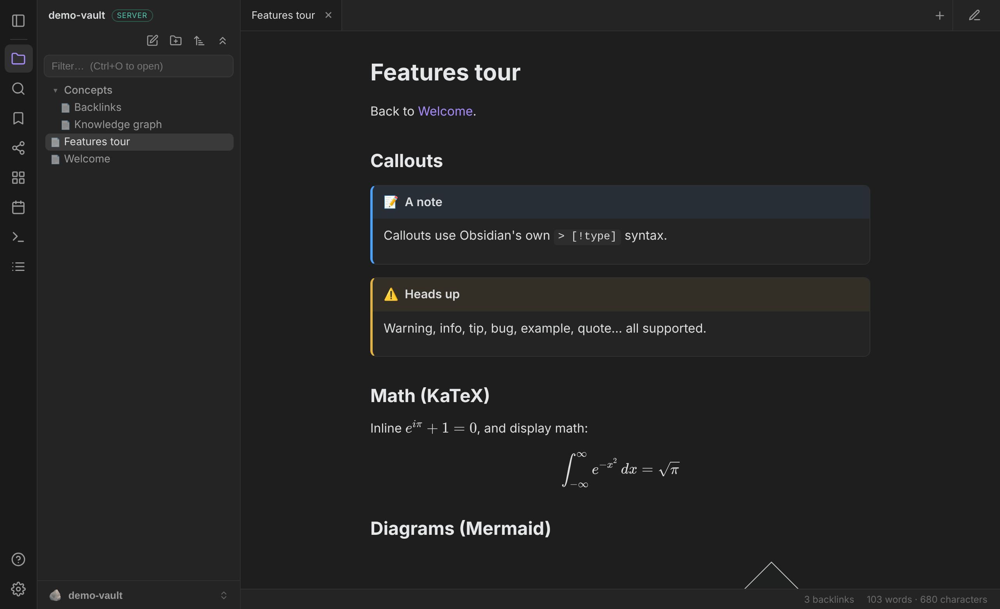
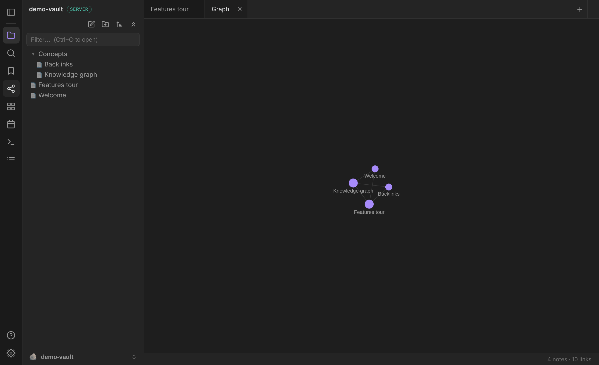

<div align="center">

# 🪨 Obsidian Web

**A free, open-source web client for your Obsidian vault.**
Open your notes in any browser — from a local folder or your own server — without changing a single file.

[](LICENSE)
[](https://zuilhose.github.io/obsidian-web/)
[](#architecture)
[](CONTRIBUTING.md)

### [▶ Try it now — no install, no upload](https://zuilhose.github.io/obsidian-web/)



</div>

## Why?

Obsidian is a great desktop app, but sometimes you just want your notes **in a browser**:
on a work laptop where you can't install anything, on a borrowed computer, or served from your
homelab to every device you own. Existing options either require a paid plan or a running copy
of the desktop app, or they quietly fill your vault with their own index and config files.

Obsidian Web is built around three rules:

1. **Non-invasive.** It reads and writes your `.md` files *exactly as they are*. It never creates
   an index, cache, lock file or hidden folder inside your vault. Delete it tomorrow and your vault
   is byte-for-byte what it would have been.
2. **Your data stays yours.** In local mode your files never leave your computer. In server mode
   they never leave your server. No accounts, no telemetry, no cloud.
3. **Open source, forever.** MIT-licensed, no build step, plain JavaScript — easy to read, fork
   and hack on.

> Obsidian Web is an independent community project. It is not affiliated with or endorsed by
> Obsidian / Dynalist Inc. If you use Obsidian, consider supporting them.

## Two ways to use it

| | **Local mode** | **Server mode** |
|---|---|---|
| What it is | Static page that opens a folder from your disk ([File System Access API](https://developer.mozilla.org/en-US/docs/Web/API/File_System_API)) | Small Docker container serving your vault over HTTP |
| Install | Nothing — use the [live demo](https://zuilhose.github.io/obsidian-web/) | `docker compose up -d` |
| Where files live | Your computer, never uploaded | Your server |
| Browsers | Chrome, Edge, Brave, Opera (desktop) | Any modern browser, incl. mobile |
| Good for | Quick access on any desktop | Homelab, phone/tablet access, sharing read-only |

## Features

- 📁 File tree with filter, collapse, and Obsidian-style ribbon and sidebar
- 🗂️ **Tabs**, just like Obsidian (open, switch, close, new tab)
- 🔗 `[[Wikilinks]]`, aliases `[[note|alias]]`, headings `[[note#heading]]`
- 🖼️ Embeds: `![[image.png]]` and standard `` images
- 🔙 **Backlinks** at the bottom of every note
- 🕸️ **Graph view** — force-directed, draggable, zoomable, click to open
- 🔍 Full-text **search** and fuzzy **quick switcher** (`Ctrl+O` / `Ctrl+P`)
- ∑ **Math** with KaTeX (`$inline$` and `$$block$$`)
- 📊 **Mermaid** diagrams
- 💬 **Callouts** (`> [!note]`, `> [!warning]`, …) with Obsidian's colors
- ☑️ **Clickable tasks** that save back to the file
- ✏️ Edit and save notes (`Ctrl+E`, `Ctrl+S`), create new notes
- 🔒 Optional read-only mode



## Quick start

### Local mode (zero install)
Open **<https://zuilhose.github.io/obsidian-web/>**, click **Open vault folder**, and pick your vault.
That's it. Everything runs in your browser.

Want to run it offline? Any static file server works:
```bash
git clone https://github.com/ZuilhoSe/obsidian-web
cd obsidian-web/frontend && python3 -m http.server 8000
```

### Server mode (Docker)
```bash
git clone https://github.com/ZuilhoSe/obsidian-web
cd obsidian-web
VAULT_PATH=/path/to/your/vault docker compose up -d --build
# → http://localhost:8099
```
Without `VAULT_PATH` it starts with the bundled demo vault (`examples/demo-vault`).

| Variable | Default | Meaning |
|---|---|---|
| `VAULT_PATH` | `./examples/demo-vault` | Your vault on the host |
| `PORT` | `8099` | Host port (bound to `127.0.0.1`) |
| `READ_ONLY` | `false` | `true` disables all writes |

> ⚠️ **Server mode has no built-in login, on purpose.** Put it behind something that does
> authentication — Cloudflare Access, Authelia, Authentik, Tailscale, or basic auth in
> Caddy/nginx — before exposing it to the internet.

**Already running a reverse proxy in Docker?** Attach the container to its network:
```bash
echo "COMPOSE_FILE=compose.yml:compose.proxy.yml" >> .env
echo "PROXY_NETWORK=your_proxy_network" >> .env
docker compose up -d --build   # proxy reaches it at http://obsidian-web:8000
```

### Syncing
Obsidian Web doesn't sync — it works with files wherever they are. Pair server mode with
[Syncthing](https://syncthing.net/), Obsidian Sync, git, or any tool you already use to keep the
server's copy and your devices in step.

## Architecture

```
frontend/            # plain ES modules, no build step, no framework
  index.html
  js/app.js          # UI glue: tabs, tree, editor, shortcuts
  js/vault.js        # LocalAdapter (File System Access) + ServerAdapter (HTTP) — same interface
  js/render.js       # Markdown → HTML: wikilinks, embeds, KaTeX, Mermaid, callouts, tasks
  js/search.js       # in-memory index: link resolution, search, backlinks
  js/graph.js        # canvas force-directed graph
  vendor/            # marked, KaTeX, Mermaid (vendored, works offline)
backend/app.py       # FastAPI: tree / read / write / raw files, path-confined to the vault
```

The whole index lives **in memory** and is rebuilt on load — that's what keeps the vault clean.

## Roadmap

Buttons for features that aren't ready yet already appear in the UI and show *"coming soon"*.
Pick one and help build it!

- [ ] Tags pane and `#tag` navigation
- [ ] Live-preview editor (CodeMirror 6)
- [ ] Outline pane
- [ ] Bookmarks (read from `.obsidian/bookmarks.json`, never written)
- [ ] Daily notes
- [ ] Command palette
- [ ] Canvas (`.canvas`) viewer
- [ ] Frontmatter / properties view
- [ ] Light theme and Obsidian CSS snippet support
- [ ] Mobile layout polish
- [ ] PWA / offline install

## Contributing

Contributions of every size are welcome — bug reports with a Markdown snippet that renders
differently from Obsidian are just as valuable as code. See [CONTRIBUTING.md](CONTRIBUTING.md).
Issues labeled **good first issue** are a great place to start.

If Obsidian Web is useful to you, **a ⭐ on GitHub** helps other people find it.

## License

[MIT](LICENSE) © Zuilho and contributors.
