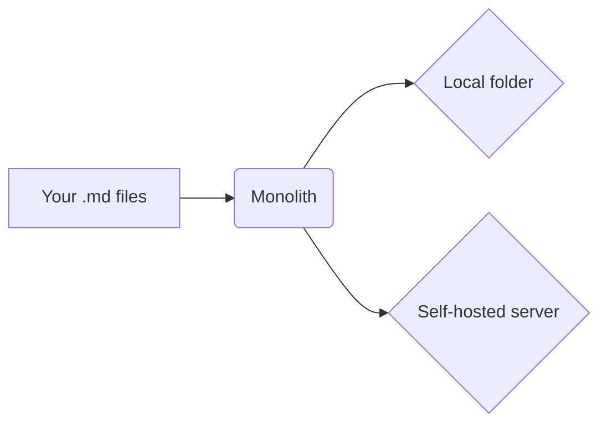

# Features tour

Back to [[Welcome]].

## Callouts
> [!note] A note
> Callouts use Obsidian's own `> [!type]` syntax.

> [!warning] Heads up
> Warning, info, tip, bug, example, quote… all supported.

## Math (KaTeX)
Inline $e^{i\pi} + 1 = 0$, and display math:

$$
\int_{-\infty}^{\infty} e^{-x^2}\,dx = \sqrt{\pi}
$$

## Diagrams (Mermaid)


## Code
```python
def non_invasive(vault):
    return "no hidden folder, no index, no lock files"
```

## Links and embeds
Wikilinks resolve by name, e.g. [[Backlinks]] or an alias: [[Knowledge graph|the graph]].
